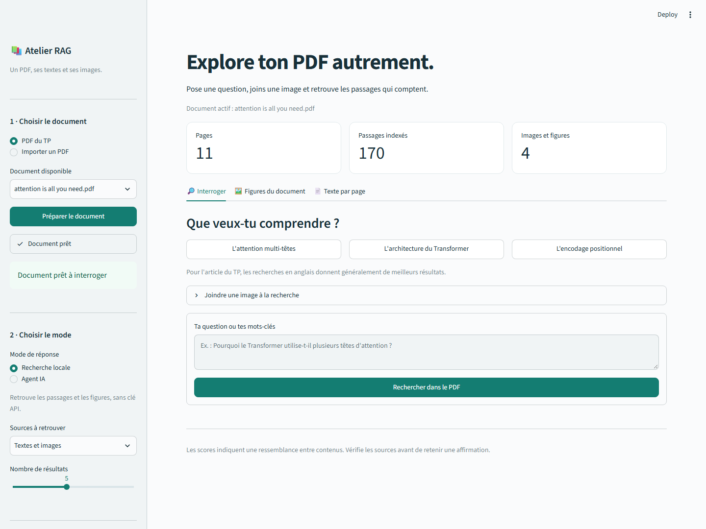
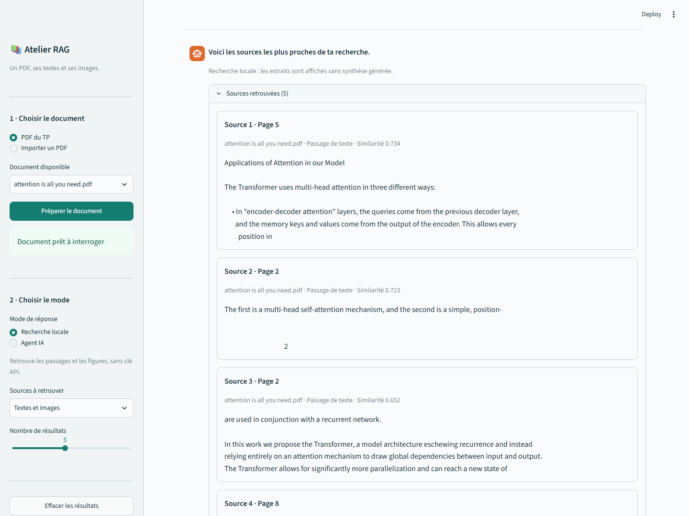
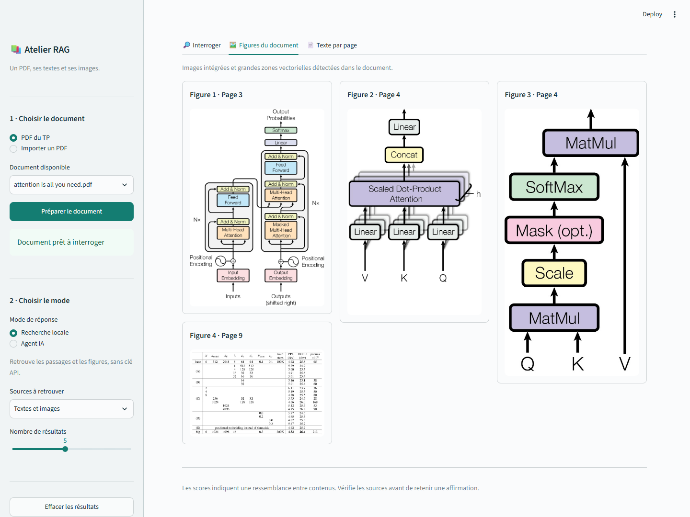
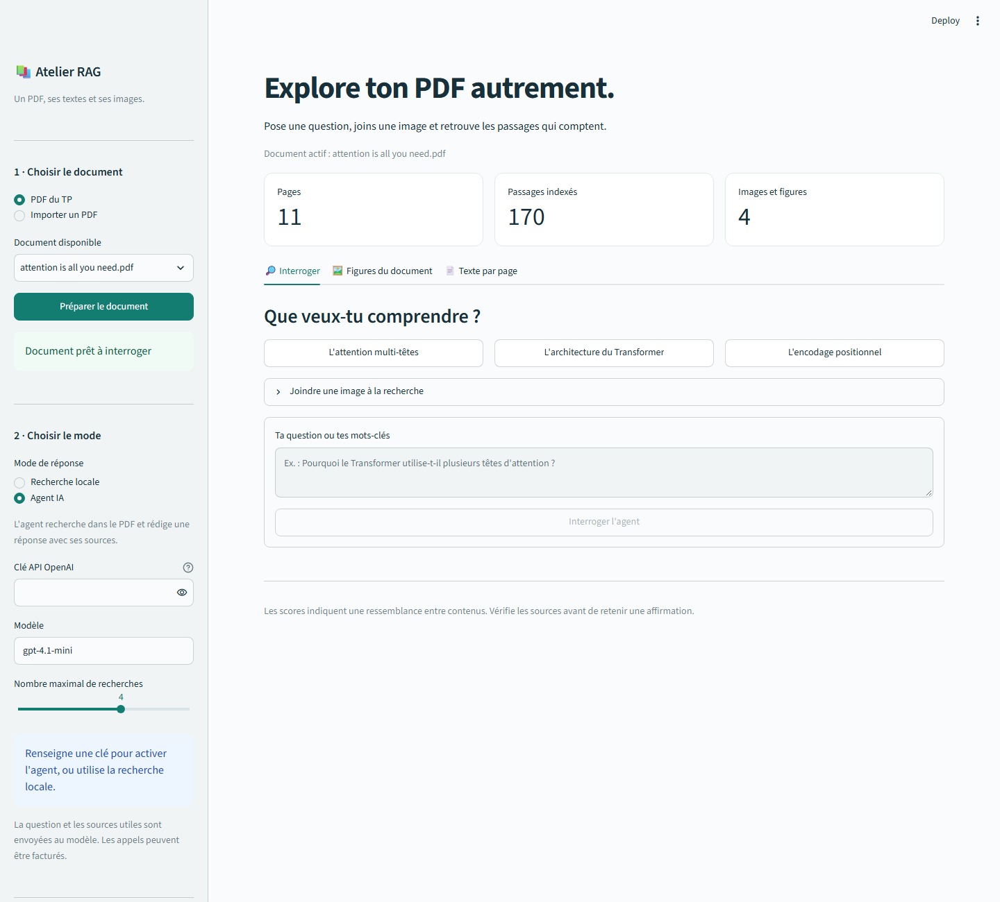
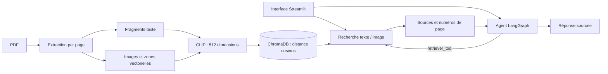
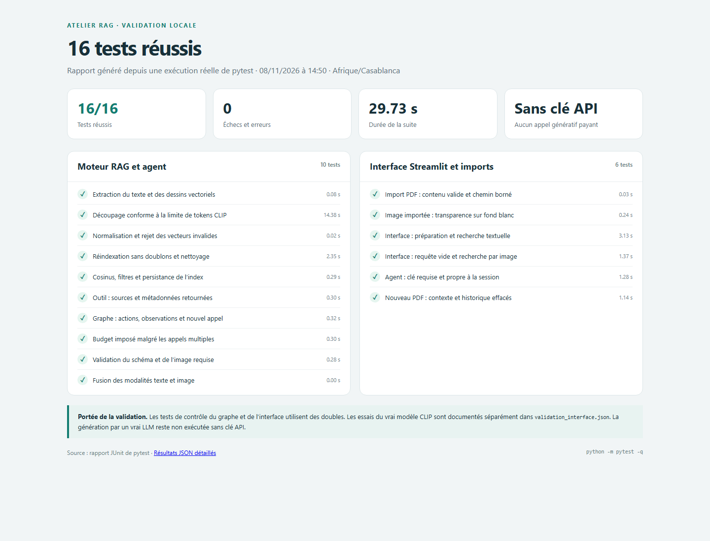

# Atelier RAG — PDF multimodal et agentique

Application **Streamlit** pour extraire le texte et les images d’un PDF, les indexer
avec **CLIP et ChromaDB**, puis les interroger par texte, par image ou avec un
**agent ReAct construit avec LangGraph**.

Le projet réalise les sept étapes du TP et utilise l’article
*Attention Is All You Need* comme document de démonstration. Le notebook,
l’interface et les tests sont inclus.

**Python 3.11 / 3.12 · Streamlit · OpenCLIP · ChromaDB · LangGraph · 16 tests validés localement**



## Fonctionnalités

- Importer un PDF ou utiliser celui du TP.
- Extraire le texte par page, les images intégrées et les grandes zones vectorielles.
- Encoder les textes et les images dans le même espace CLIP de 512 dimensions.
- Retrouver les sources par similarité cosinus, à partir d’un texte, d’une image ou des deux.
- Filtrer les résultats : textes, images ou tous les contenus.
- Obtenir une réponse rédigée et consulter les actions de l’agent, avec une clé API.
- Parcourir les figures et le texte de chaque page, puis exporter une recherche en JSON.
- Réindexer un document sans créer de doublons, grâce à son empreinte SHA-256.

| Mode | Utilisation | Clé API |
| --- | --- | --- |
| **Recherche locale** | Affiche les passages et images les plus proches de la requête | Non |
| **Agent IA** | Choisit ses recherches et rédige une réponse avec des références de pages | Oui |

La recherche locale affiche les sources sans générer de synthèse. Les poids CLIP
sont téléchargés au premier lancement, puis réutilisés localement.

## Installation

Prérequis : **Python 3.11 ou 3.12**, Git pour cloner le dépôt et une connexion Internet
pour installer les dépendances et télécharger les poids CLIP la première fois.

Après avoir cloné ou téléchargé ce dépôt, ouvrir un terminal dans son dossier.

### Windows — PowerShell

```powershell
python -m venv .venv
.\.venv\Scripts\python.exe -m pip install --upgrade pip
.\.venv\Scripts\python.exe -m pip install torch torchvision --index-url https://download.pytorch.org/whl/cpu
.\.venv\Scripts\python.exe -m pip install -r requirements.txt
```

### Linux / macOS

```bash
python3 -m venv .venv
source .venv/bin/activate
python -m pip install --upgrade pip
python -m pip install -r requirements.txt
```

Les versions exactes de l’environnement de validation Windows sont consignées dans
[`requirements-lock.txt`](requirements-lock.txt). Ce verrou contient des roues
PyTorch CPU : pour le réutiliser, ajouter
`--extra-index-url https://download.pytorch.org/whl/cpu` à l’installation.
Pour CUDA, installer les roues PyTorch adaptées au GPU avant les autres dépendances.

Les poids CLIP occupent environ **605 Mo** dans `.cache/clip`. Le dossier `.venv`,
les caches, les PDF importés et l’index local ne sont pas versionnés.

## Lancer l’interface

Sous Windows, double-cliquer sur **[`lancer_interface.bat`](lancer_interface.bat)**,
ou utiliser PowerShell :

```powershell
.\.venv\Scripts\python.exe -m streamlit run app.py --server.port 8502
```

Sous Linux / macOS, après activation de l’environnement :

```bash
python -m streamlit run app.py --server.port 8502
```

Ouvrir **[http://127.0.0.1:8502](http://127.0.0.1:8502)** dans le navigateur.
Cette adresse désigne l’application lancée sur l’ordinateur local ; le dépôt GitHub
ne constitue pas un hébergement de Streamlit. Si le port est occupé, remplacer
`8502` par `8503`. Pour arrêter le serveur : **Ctrl+C** dans son terminal.

### Utiliser l’application

1. Choisir **PDF du TP** ou **Importer un PDF** dans la barre latérale.
2. Cliquer sur **Préparer le document** et attendre la fin de l’extraction et de l’indexation.
3. En **Recherche locale**, choisir le type de sources et le nombre de résultats.
4. Saisir une question, ou ouvrir **Joindre une image à la recherche** pour importer
   une image ou sélectionner une figure du PDF. Une image seule est acceptée.
5. Cliquer sur **Rechercher dans le PDF**, puis vérifier les extraits, les images et les pages sources.
6. Utiliser **Figures du document** et **Texte par page** pour parcourir le PDF.

Exemples adaptés au document du TP :

```text
Why does the Transformer use multi-head attention?
Explain the Transformer encoder-decoder architecture.
How does sinusoidal positional encoding work?
```

CLIP étant surtout anglophone, les recherches en anglais sont conseillées pour cet
article. Le mode agent répond en français. Les PDF importés sont limités à **30 Mo**,
les images à **10 Mo**. Changer de PDF efface les résultats précédents de la session.

## Captures de l’interface

Les images ci-dessous sont des captures réelles de l’application locale. Elles sont
versionnées dans [`docs/screenshots`](docs/screenshots) et utilisent des chemins
relatifs pour s’afficher dans le README sur GitHub.

### Recherche textuelle et pages sources

Les résultats présentent le passage retrouvé, le nom du PDF, le numéro de page et
le score de similarité. Ce score mesure une ressemblance, pas une probabilité de vérité.



### Galerie des figures

Le document du TP contient trois images intégrées. Un tableau vectoriel est aussi
rendu en image, soit quatre contenus visuels exploitables au total.



### Configuration de l’agent IA

Le mode agent permet de saisir une clé masquée, de choisir le modèle et de borner
le nombre de recherches. **Cette capture montre la configuration sans clé API ;
elle ne représente pas une réponse générée par un vrai LLM.**



## Activer les réponses de l’agent

Sélectionner **Agent IA** et saisir la clé dans le champ **Clé API OpenAI**.
Autre possibilité : définir `OPENAI_API_KEY` dans le processus avant le lancement.
Le modèle par défaut est `gpt-4.1-mini`, configurable dans l’interface ou avec
`OPENAI_MODEL`. Il doit accepter les images et les appels d’outils.

La clé saisie dans l’interface reste propre à la session : elle n’est pas écrite
dans un fichier ni placée dans le cache partagé. Les questions et les sources utiles
sont transmises au fournisseur du modèle ; les appels peuvent être facturés.

Dans le notebook, une saisie masquée est possible :

```python
from getpass import getpass
import os

os.environ["OPENAI_API_KEY"] = getpass("Clé API : ")
```

Réexécuter ensuite la cellule des paramètres, les définitions et les essais de
l’agent. Ne pas enregistrer de clé littérale dans une cellule ou dans le dépôt.

## Architecture



Le cycle de l’agent est compilé explicitement :
`START → mind → body → mind → … → END`.
Le modèle choisit une action, l’outil renvoie une observation et le modèle produit
une synthèse ou recherche à nouveau. Le budget d’appels est imposé dans le code.

## Tests et résultats

Dernière exécution documentée : **8 novembre 2026 — 16 tests réussis, 0 échec**.
Le [rapport HTML](docs/test-results/rapport-tests.html) et les
[résultats JSON](docs/test-results/resultats.json) sont générés depuis le rapport
JUnit de pytest. Pour consulter le HTML, le télécharger ou l’ouvrir localement.



### Ce que couvrent les tests

| Fichier | Nombre | Vérifications |
| --- | ---: | --- |
| [`tests/test_tp.py`](tests/test_tp.py) | 10 | Extraction, découpage CLIP, normalisation, indexation sans doublons, filtres, persistance, outil et boucle d’agent avec budget |
| [`tests/test_interface.py`](tests/test_interface.py) | 6 | Import de fichiers, transparence des images, parcours Streamlit, image seule, clé propre à la session et changement de document |

Les tests de contrôle du graphe et des parcours Streamlit utilisent des doubles
pour isoler le comportement attendu. Ils ne nécessitent ni clé API ni appel payant
et ne mesurent pas les décisions autonomes d’un vrai LLM.

Des contrôles complémentaires ont utilisé le **véritable modèle CLIP** sur le PDF :

| Contrôle | Résultat observé | Preuve |
| --- | --- | --- |
| Extraction et indexation | 11 pages, 170 fragments texte et 4 images, soit 174 éléments | [`validation.json`](validation.json) |
| Réindexation | Aucun nouveau doublon | [`validation.json`](validation.json) |
| Recherche textuelle | Une page attendue retrouvée dans le top-5 pour chacune des 4 questions annotées | [`validation_retrieval.json`](validation_retrieval.json) |
| Recherche image dans l’interface | L’image connue retrouve sa source, page 3, avec un cosinus de 1,000 | [`validation_interface.json`](validation_interface.json) |
| Contrôle navigateur | Préparation du PDF, résultats textuels et galerie affichés | Captures de l’interface et [`validation_interface.json`](validation_interface.json) |
| Génération par un vrai LLM | **Non exécutée : clé API non configurée pendant la validation** | [`validation_interface.json`](validation_interface.json) |

Le test image→image réutilise une image déjà indexée : il vérifie le fonctionnement
du parcours, sans mesurer la généralisation à de nouvelles images. Les quatre
questions annotées forment un petit jeu de contrôle, pas une évaluation exhaustive.

### Exécuter les tests

Sous Windows :

```powershell
.\.venv\Scripts\python.exe -m pytest -q
```

Sous Linux / macOS, avec l’environnement activé :

```bash
python -m pytest -q
```

Pour refaire le contrôle de l’interface avec le **vrai modèle CLIP** :

```powershell
.\.venv\Scripts\python.exe scripts/smoke_interface.py
```

Ce script utilise `AppTest`, prépare le PDF du TP et vérifie une recherche à partir
d’une figure. Les poids CLIP doivent être disponibles ou téléchargeables ; aucune
clé API n’est requise.

Pour régénérer le rapport de tests :

```powershell
.\.venv\Scripts\python.exe -m pytest -q --junitxml=.cache/pytest-readme.xml
.\.venv\Scripts\python.exe scripts/build_test_report.py
```

Le rapport HTML et le JSON sont alors mis à jour. La capture `05-tests.png` reste
un instantané de l’exécution documentée ; la refaire après une nouvelle validation.

## Notebook du TP

Ouvrir [`TP_RAG_multimodal_agentique.ipynb`](TP_RAG_multimodal_agentique.ipynb)
dans VS Code ou Jupyter, sélectionner le noyau de l’environnement `.venv`, puis
exécuter toutes les cellules. Les définitions sont incluses dans le notebook.

```powershell
.\.venv\Scripts\python.exe scripts/execute_notebook.py
```

Le script exécute le notebook avec le Python courant, sauvegarde les sorties et
exporte [`TP_RAG_multimodal_agentique.html`](TP_RAG_multimodal_agentique.html).
Sans clé, les cinq scénarios génératifs sont laissés prêts à lancer et le contrôle
du graphe utilise un scénario explicitement simulé.

Pour régénérer le notebook depuis les modules, puis le réexécuter :

```powershell
.\.venv\Scripts\python.exe scripts/build_notebook.py
.\.venv\Scripts\python.exe scripts/execute_notebook.py
```

La régénération remplace les sorties conservées du notebook.

## Organisation du dépôt

```text
.
├── app.py                         # Interface Streamlit
├── streamlit_backend.py           # Chargement des fichiers et services de l’interface
├── rag_multimodal.py              # Extraction, CLIP et ChromaDB
├── agent_rag.py                   # Outil documentaire et agent LangGraph
├── lancer_interface.bat           # Lanceur Windows
├── requirements.txt
├── requirements-lock.txt
├── .streamlit/config.toml         # Thème et configuration locale
├── pdfs/                         # PDF de démonstration
├── resultats_pdf/                # Textes, images et manifeste du PDF du TP
├── docs/
│   ├── screenshots/              # Captures utilisées dans ce README
│   └── test-results/             # Rapport HTML et résultats JSON
├── tests/                        # 16 tests pytest
├── scripts/                      # Exécution, rapports et préparation de l’archive
├── TP_RAG_multimodal_agentique.ipynb
└── validation*.json              # Résultats des contrôles exécutés
```

